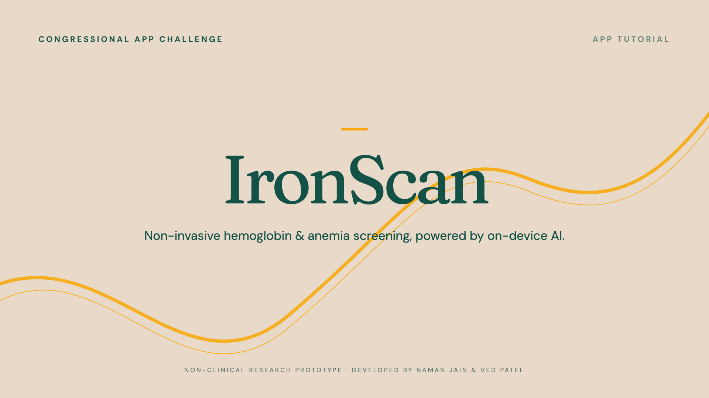
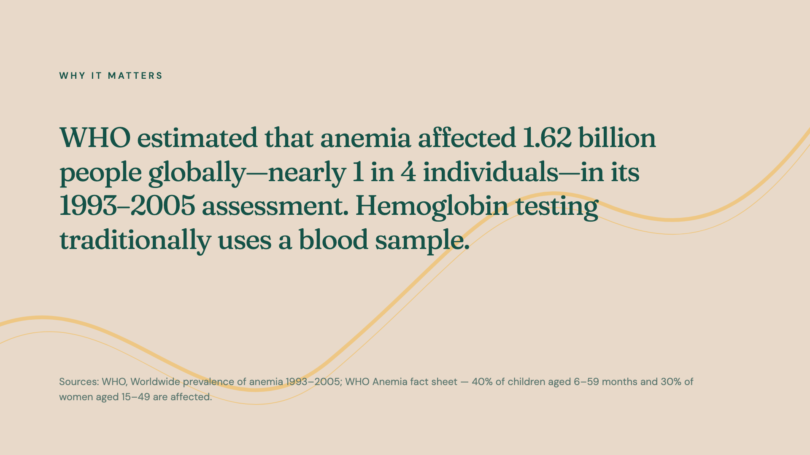
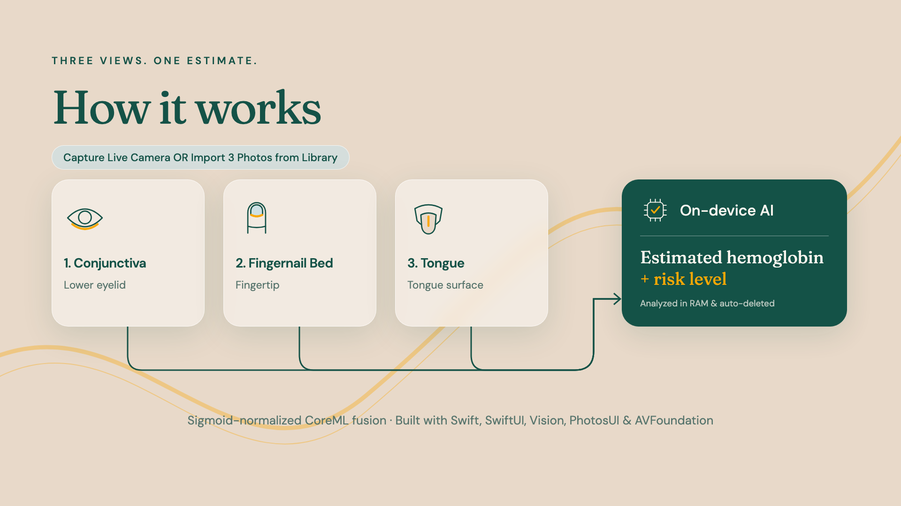
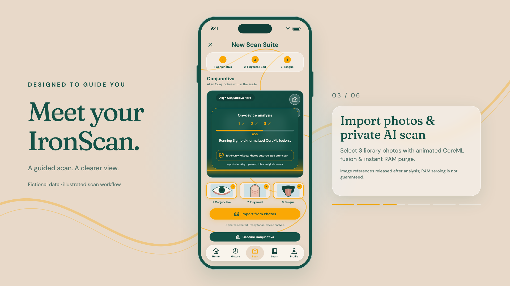
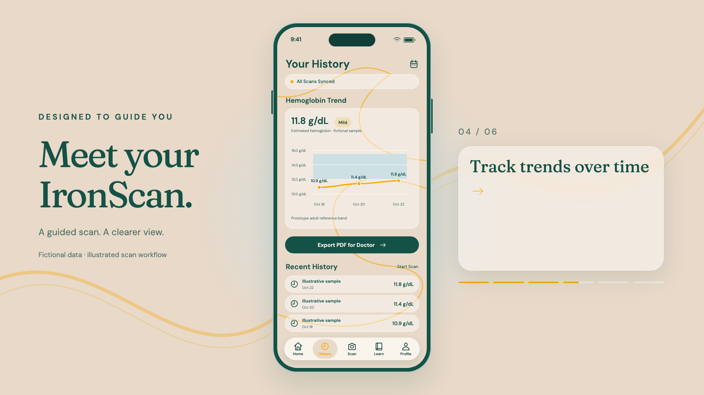

<div align="center">



# IronScan

### Non-Invasive Hemoglobin & Anemia Screening, Powered by On-Device AI

**2026 Congressional App Challenge Submission**<br/>
**Developed by Naman Jain & Ved Patel**

[](https://developer.apple.com/ios/)
[](https://swift.org)
[](https://developer.apple.com/xcode/swiftui/)
[](https://developer.apple.com/documentation/coreml)
[](#4-privacy-and-image-lifecycle)

**A non-clinical research prototype. Experimental estimates are not diagnoses or validated measurements and do not replace laboratory testing.**

</div>

---

## 1. Mission & Why It Matters



IronScan explores whether a smartphone can support a more accessible first step in hemoglobin and anemia-risk research. It brings guided image collection, local model execution, and longitudinal numerical history into one iOS experience.

WHO's **1993–2005 assessment estimated 1.62 billion people affected by anemia—24.8% of the global population at that time**. Separately, WHO's anemia fact sheet reports approximately **40% of children aged 6–59 months** and **30% of women aged 15–49 years** affected. These figures describe different assessment periods and populations; the 1.62 billion figure is a historical estimate, not a 2026 prevalence claim.

Sources: [WHO, Worldwide prevalence of anaemia 1993–2005](https://www.who.int/publications/i/item/9789241596657) and [WHO, Anaemia fact sheet](https://www.who.int/news-room/fact-sheets/detail/anaemia).

The prototype analyzes images from three anatomical sites:

- **Palpebral conjunctiva:** the inner lower eyelid.
- **Fingernail bed:** the visible nail-bed region.
- **Tongue:** the tongue surface.

The research question concerns optical patterns and their relationship to hemoglobin. The project does not establish that a phone image can diagnose anemia, determine its cause, or substitute for a blood test.

## 2. Multimodal Machine Learning & Core ML Pipeline



**Image analysis runs on the device.** The implementation uses Swift, SwiftUI, Core ML, Vision, AVFoundation, PhotosUI, and Combine. Camera work, image loading, Vision checks, inference, persistence, and UI publication use their designated actors under Swift 6 complete strict-concurrency checking.

The three-photo assessment path:

1. **Acquire images:** capture through the guided camera suite or select up to three images with the ordered Photos picker.
2. **Check image quality and framing:** heuristic brightness/focus checks and Vision face/hand guidance support acquisition. These checks are engineering safeguards, not a validated anatomical classifier.
3. **Prepare model input:** the assessment prepares **224 × 224 pixel buffers** for the three tissue heads. Model manifests and Python/Swift parity fixtures remain the reference for the corresponding model contracts; other engines may use different contracts.
4. **Run specialized models:** `ConjunctivaPallor.mlpackage`, `NailHemoglobin.mlpackage`, and `TonguePallor.mlpackage` supply tissue-specific scores. These models are bundled under `CoreAndML/`.
5. **Normalize and combine scores:** the assessment implementation applies sigmoid normalization to the nail head's raw scalar; the eye and tongue heads already supply probability-scale scores. It does **not** apply a second sigmoid indiscriminately to every output.

$$\sigma(x) = \frac{1}{1 + e^{-x}}$$

The normalized scores feed the prototype's multimodal fusion and experimental hemoglobin/risk presentation. The UI can display an estimated value in **g/dL** and **Normal, Mild, Moderate, or Severe** tiers. These labels and mappings do not establish clinical calibration or accuracy.

Relevant implementation: [assessment view model](Apps/IronScan/IronScan/CoreAndML/MultiScanHubViewModel.swift), [multimodal fusion](Apps/IronScan/IronScan/CoreAndML/TriangulationEngine.swift), and [model contracts](Models/Manifests/).

Core ML may select CPU, GPU, or Neural Engine execution according to device and operation support. No claim is made that every operation uses the Neural Engine. Authentication, configured numerical-history synchronization, and nearby-care lookup can use a network; on-device image inference should not be confused with a completely offline app.

## 3. Core Features & App Walkthrough

### Guided Capture, Library Import & Private Image Handling



- **Guided live camera suite:** a three-step workflow with an alignment guide, camera-switch controls, and torch controls when supported by the device.
- **Ordered Photos import:** up to three selected images populate the corresponding tissue slots; incomplete selections can fill remaining slots. Import and assessment are separate actions.
- **Liquid Glass analysis presentation:** completion indicators, a laser-style scan animation, and fusion progress make the research workflow visible.
- **Ephemeral assessment images:** the assessment releases session-owned image references after success, error, or cancellation; numerical history has a separate lifecycle.

The import screenshot above is an **original React/SVG motion illustration with synthetic anatomical thumbnails**. It demonstrates the workflow and is not a recording of participant images, a model benchmark, or evidence of memory-security guarantees.

### Trends, Education & Report Previews



- **Shared Home and History records:** the dashboard, latest estimate, and trend use a consistent numerical-history projection. The README illustrations use fictional values; the three-point graph shows **10.9 → 11.4 → 11.8 g/dL**.
- **Hemoglobin trend chart:** visualizes experimental readings over time with a prototype adult reference band. That band is illustrative and must not be treated as an individual clinical threshold.
- **Apple Health Vitals preview:** the current Home/History cards demonstrate fixed sample values and a simulated sync interaction. These cards do not fetch live HealthKit samples. Separate HealthKit service code does not make this preview a validated live integration.
- **Doctor report preview:** the History button opens a dismissible sample research-report layout. It does not currently generate and share a PDF in that flow; sample confidence values are not measured model performance.
- **Learn and profile:** educational material, lighting context, skin-phototype inputs, and demographic calibration settings support the research experience. Optical fairness across skin tones has not been established by entering those settings.

## 4. Privacy and Image Lifecycle

Assessment images are decoded and processed in memory without creating app photo files in the assessed import path. After analysis, cleanup clears the session's image dictionary, captured-frame aliases, thumbnails, pending capture, tongue image, and camera-manager image references.

**What this means:** the app releases the references it owns. **What it does not mean:** secure zeroing of physical RAM, deletion of framework/OS caches, or deletion of originals from the Photos library. ARC reference release cannot guarantee those outcomes. The animation's “auto-deleted” label refers to imported working copies; the on-screen small print makes this distinction explicit.

Numerical result summaries are intentionally retained in local history. Account services or configured numerical sync are separate from image processing. Raw tongue images stay local outside explicitly enabled Developer Mode. The optional [synthetic engineering server](Server/README.md) is separate from normal on-device inference. No participant images or medical records are included in the README assets.

## 5. Repository Structure

The **main iOS target** has two source folders. Shared libraries, training, and documentation remain separate so Xcode does not ingest the Python toolchain as application sources.

```text
conrad-challenge-ironscan/
├── Apps/IronScan/
│   ├── IronScan.xcodeproj/             # Maintained explicit Xcode references
│   ├── IronScan/
│   │   ├── AppAndUI/                  # Views, navigation, themes, animations
│   │   │   ├── IronScanApp.swift
│   │   │   ├── MainTabView.swift       # Includes HistoryView, LearnView, ProfileView
│   │   │   ├── HomeDashboardView.swift
│   │   │   ├── MultiScanHubView.swift
│   │   │   └── IronTheme.swift
│   │   ├── CoreAndML/                 # Models, inference, camera, storage, services
│   │   │   ├── ConjunctivaPallor.mlpackage/
│   │   │   ├── NailHemoglobin.mlpackage/
│   │   │   ├── TonguePallor.mlpackage/
│   │   │   ├── ScanModels.swift
│   │   │   ├── TriangulationEngine.swift
│   │   │   ├── MedicalCameraManager.swift
│   │   │   ├── MultiScanHubViewModel.swift
│   │   │   └── ScanHistoryStore.swift
│   │   ├── Info.plist
│   │   └── IronScan.entitlements
│   └── IronScanTests/                 # App and model tests
├── Packages/                          # Shared Swift core, models, networking, test support
├── Models/                            # Shared runtime artifacts, manifests, checksums
├── MLTraining/                        # Python training, conversion, dataset provenance
├── PythonReference/                   # Reference preprocessing and parity checks
├── TestFixtures/                      # Synthetic / licensed engineering fixtures
├── Video/IronScanIntro/               # Remotion source and fictional demo inputs
├── docs/readme_assets/                # Five 1920×1080 PNGs and export manifest
└── scripts/                           # Build, parity, provenance, layout checks
```

The reorganization preserves moved source and model content byte-for-byte. Its [relocation map](docs/repository-reorganization-map.json) records original/new paths and hashes. No model preprocessing, manifest, or trained weights were changed. Local service configuration remains ignored and is not a prerequisite resource for the checked-in Xcode project.

## 6. Build & Run

**Requirements:** macOS, an Xcode toolchain supporting Swift 6 and the APIs used by the app (validated locally with Xcode 26.6), and an iOS 18+ simulator or device. Use the checked-in Xcode project; XcodeGen is not required to build the submission.

```sh
git clone https://github.com/man-coding-j/conrad-challenge-ironscan.git
cd conrad-challenge-ironscan
open IronScan.xcworkspace
```

Select the **IronScan** scheme and a simulator, then run. For a physical device, configure your own signing team and capabilities. Account-dependent features require your own service configuration; do not commit credentials. Simulator fixtures support local engineering demonstrations without participant images.

Command-line simulator build from the repository root:

```sh
python3 scripts/check_repository_layout.py
xcodebuild -project Apps/IronScan/IronScan.xcodeproj -scheme IronScan \
  -destination 'generic/platform=iOS Simulator' CODE_SIGNING_ALLOWED=NO build
```

Standalone Swift / Python validation:

```sh
swift test
uv sync --all-groups
uv run pytest PythonReference/tests
```

For training and conversion details, see [MLTraining](MLTraining/README.md); for model and data provenance, see [compliance](compliance/) and [third-party notices](THIRD_PARTY_NOTICES.md).

## 7. Submission Media & Reproducibility

The **32-second, 1920×1080, 60 fps** intro is generated with Remotion/React/TypeScript. The five README images are direct lossless PNG renders of that same composition at **2.5 s, 6.5 s, 12 s, 21.5 s, and 24.5 s**. The [asset manifest](docs/readme_assets/manifest.json) records frame numbers, dimensions, and checksums.

```sh
cd Video/IronScanIntro
npm ci
npx remotion studio
npm run export-readme
npm run render
```

The output MP4 is `Video/IronScanIntro/out/new.mp4`; rendered videos and dependency caches are generated locally rather than stored in Git. The generator's [README](Video/IronScanIntro/README.md) documents scene timing, fictional inputs, and the blank-phone-frame verifier. No music is embedded.

## 8. Validation & Research Limits

The reorganized checked-in project passed the requested generic iOS Simulator build with **zero build errors and no missing-file errors**. [Repository organization validation](docs/repository-organization-validation.md) records the layout/hash audit, build evidence, media checks, and focused regression results.

The prior full simulator suite recorded **167 tests with 17 assertion failures across 8 test cases**, including image-quality, palette, and triangulation expectations. Those unresolved failures are documented in [the earlier workspace validation](docs/final-workspace-build-validation.md); a successful build must not be presented as an entirely passing test suite.

Physical-device lens switching, mirroring, torch behavior, preview/capture alignment, inference performance, calibration, and clinical accuracy still require validation. The project is a research prototype and does not establish diagnostic or treatment utility.

## 9. Team & License

**Naman Jain & Ved Patel** — 2026 Congressional App Challenge.

Copyright 2026 IronScan contributors. **All rights reserved** under the repository's [LICENSE](LICENSE). Publication of the source does not grant a software or model license. Third-party assets and datasets retain their own terms; see [THIRD_PARTY_NOTICES.md](THIRD_PARTY_NOTICES.md).
